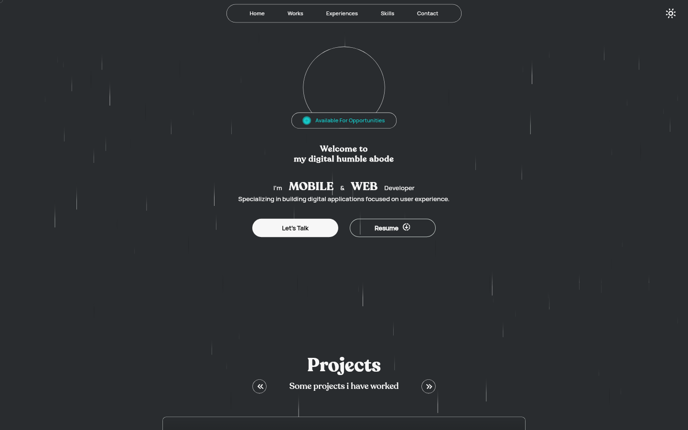
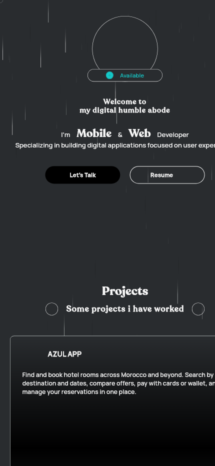

# Mohamed Ezriouil — Flutter Portfolio

A responsive, animated portfolio built with Flutter Web and Firebase. It presents projects, professional experience, technical skills, contact links, and a downloadable résumé in a single-page experience.

[](https://mohamedezriouil.com/)
[](https://flutter.dev/)
[](LICENSE)

## Preview

### Desktop



### Mobile

<p align="center">
  
</p>

## Features

- Responsive layouts for mobile, tablet, and desktop
- Animated landing page, skill displays, project cards, and experience timeline
- Light and dark themes
- Firestore-backed projects and experience entries
- Firebase Analytics and Remote Config integration
- Contact form powered by EmailJS
- Firebase Hosting configuration with caching and security headers
- SEO assets including a sitemap, robots file, metadata, and Google verification

## Tech stack

- Flutter and Dart
- GetX for state management and navigation
- Firebase Core, Cloud Firestore, Analytics, Remote Config, and Hosting
- EmailJS for contact-form delivery

## Getting started

### Prerequisites

- [Flutter](https://docs.flutter.dev/get-started/install) 3.38 or newer
- Dart 3.10 or newer
- A Firebase project
- An EmailJS account if you want the contact form to send messages

### Installation

```bash
git clone https://github.com/ezriouil/Portfolio.git
cd Portfolio
flutter pub get
flutter run -d chrome
```

## Make it your own

1. Replace the personal copy, social links, and fallback résumé URL in `lib/`.
2. Replace the images, icons, and fonts in `assets/` while preserving or updating their paths in `pubspec.yaml`.
3. Configure your own Firebase project:

   ```bash
   dart pub global activate flutterfire_cli
   flutterfire configure
   ```

4. Create `PROJECTS` and `EXPERIENCES` collections in Firestore. The entity classes in `lib/common/models/` show the expected fields.
5. Replace the EmailJS service, template, and public user IDs in `lib/home/home_controller.dart`.
6. Review `firebase.json`, `.firebaserc`, `web/index.html`, `web/robots.txt`, and `web/sitemap.xml` for project-specific domains and IDs.
7. Protect Firestore with security rules appropriate for your data. Never place admin passwords or private credentials in Flutter client code.

Firebase web configuration values and EmailJS public keys identify client projects but do not authorize privileged access. Keep server secrets out of the repository and enforce access through Firebase Security Rules or a trusted backend.

## Quality checks

```bash
flutter analyze
flutter test       # once tests are added
flutter build web --release
```

## Deployment

Build and deploy to Firebase Hosting:

```bash
flutter build web --release
firebase deploy --only hosting
```

The generated `build/` directory and local `.firebase/` deployment cache are intentionally ignored.

## Contributing

Issues and pull requests are welcome. If you build your own portfolio from this project, a link back is appreciated but not required.

## License

Distributed under the [MIT License](LICENSE). You may use, modify, and distribute this project for personal or commercial work.
